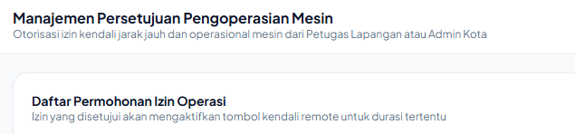

# MASTER DEVELOPMENT PROMPT
# SMART GREEN COMPOSTER
## ZeroWaste Green

You are a senior full-stack software architect, Laravel developer, UI/UX designer, database engineer, and AI integration engineer.

Your task is to design and develop a complete, production-oriented web application called **Smart Green Composter**, an IoT-based organic waste management platform developed by the ZeroWaste Green team.

Build the application as a real, functional, maintainable Laravel project. Do not create merely static mockup pages or disconnected frontend demonstrations.

The application must initially operate using realistic mock IoT data while following a well-defined API contract, allowing future integration with an actual IoT API with minimal code changes.

---

# 1. CORE DEVELOPMENT PRINCIPLES

Follow these principles throughout the project:

1. Build one integrated Laravel project.
2. Do not create separate IoT firmware, IoT server, Python AI service, or standalone frontend projects.
3. Keep IoT integration and AI integration inside Laravel using dedicated service classes.
4. Use realistic mock data for initial development.
5. Design mock data according to the expected future API request and response structures.
6. Separate application logic from external data providers.
7. Implement actual database relationships, validation, authentication, authorization, and CRUD operations.
8. Do not use hardcoded values as substitutes for functional backend features.
9. Make every button, form, menu, filter, and action functional.
10. Ensure all important interfaces are responsive, accessible, and mobile-first.
11. Use consistent naming, reusable components, and maintainable code.
12. Never expose private information or API credentials to public users.

Before coding, inspect the existing project directory and its dependencies.

If a Laravel project already exists, continue using its structure. Do not unnecessarily recreate the project, delete existing work, or replace working components.

If the directory is empty, initialize a Laravel project.

---

# 2. TECHNOLOGY STACK

Use the following technologies:

Backend:
- Laravel
- PHP
- MySQL
- Laravel Authentication
- Laravel Policies and Gates or Spatie Laravel Permission
- Laravel Notifications
- Laravel Queue where necessary

Frontend:
- Blade
- Livewire
- Alpine.js
- Tailwind CSS
- Lucide icons

Maps:
- Leaflet
- OpenStreetMap

IoT:
- Laravel-based API integration layer
- Mock IoT provider initially
- HTTP API provider for future integration

AI:
- Provider-independent AI integration layer
- External AI API
- Configurable provider and model
- Database-backed public knowledge base

Optional:
- Laravel Reverb for real-time updates
- Redis for caching and queues
- Web Push API with VAPID

Do not introduce additional frameworks or services without a clear technical reason.

---

# 3. DESIGN SYSTEM — WHITE GREEN CLEAN

The entire application must use a consistent, professional visual identity.

Design direction:

**White – Green – Clean – Modern – Professional**

Primary colors:
- White: #FFFFFF
- Primary green: #16834A
- Dark green: #105C38
- Soft green: #EAF5EE
- Main text: #17251D
- Secondary text: #68756D
- Border: #E6EBE7
- Background: #F7F9F7

Use colors consistently. Do not use excessive green backgrounds.

Typography:
- Use Inter, Manrope, or another suitable modern sans-serif.
- Establish consistent typography scales.
- Maintain readable font sizes and line heights.
- Avoid excessively large headings.

UI characteristics:
- Clean layouts.
- Clear visual hierarchy.
- Proportional spacing.
- Subtle borders.
- Minimal shadows.
- Consistent button sizes.
- Carefully selected icons.
- Professional tables and charts.
- Clear status indicators.
- Restrained use of rounded corners.

Avoid:
- Excessive gradients.
- Glassmorphism.
- Random floating decorations.
- Excessive rounded cards.
- Oversized headings.
- Excessive icons.
- Unnecessary animations.
- Artificial-looking AI-generated dashboard aesthetics.
- Decorative elements that reduce usability.
- Dense layouts with insufficient spacing.

The result must look like a professionally designed environmental technology platform, not a generic AI-generated admin template.

## Mobile-first requirements

Design for mobile screens first.

Then progressively adapt to:
- Tablet.
- Laptop.
- Desktop.
- Wide desktop screens.

Mobile requirements:
- Responsive navigation.
- Collapsible sidebar or mobile drawer.
- Touch-friendly buttons.
- Properly spaced forms.
- Responsive charts.
- Horizontally scrollable tables only when necessary.
- Cards or alternative compact layouts for important mobile data.
- Responsive map containers.
- No horizontal overflow.
- Properly positioned chatbot widget.
- Accessible modal and dropdown interactions.

Do not simply shrink the desktop layout to fit mobile.

Every page must be independently checked at mobile and desktop breakpoints.

---

# 4. PROJECT STRUCTURE

Keep everything inside one Laravel project.

Recommended organization:

smart-green-composter/
├── app/
│   ├── Actions/
│   ├── Enums/
│   ├── Http/
│   │   ├── Controllers/
│   │   ├── Middleware/
│   │   └── Requests/
│   ├── Livewire/
│   │   ├── Admin/
│   │   └── Public/
│   ├── Models/
│   ├── Notifications/
│   ├── Policies/
│   ├── Services/
│   │   ├── IoT/
│   │   │   ├── Contracts/
│   │   │   ├── Providers/
│   │   │   ├── IoTService.php
│   │   │   └── DTOs/
│   │   ├── AI/
│   │   │   ├── Contracts/
│   │   │   ├── Providers/
│   │   │   ├── AIService.php
│   │   │   └── KnowledgeBaseService.php
│   │   └── Audit/
│   └── Support/
├── bootstrap/
├── config/
├── database/
│   ├── factories/
│   ├── migrations/
│   └── seeders/
├── public/
├── resources/
│   ├── css/
│   ├── js/
│   └── views/
│       ├── layouts/
│       ├── components/
│       ├── admin/
│       └── public/
├── routes/
├── storage/
├── tests/
├── .env.example
├── composer.json
├── package.json
└── README.md

This is a suggested organization, not a requirement to create empty directories unnecessarily.

Keep the public website, admin dashboard, chatbot, IoT integration, and AI integration within the same Laravel application.

Do not create:
- iot-firmware/
- iot-server/
- ai-service/
- frontend/
- separate Python applications.

The actual ESP32 firmware and IoT server will be developed or provided separately in the future.

---

# 5. USER ROLES AND ACCESS CONTROL

Implement four primary roles.

Hierarchy:

1. Master Admin
2. Admin Kota
3. Admin RT/RW
4. Admin Lapangan

Use role-based access control and regional data scoping.

Never rely on frontend menu visibility alone. Every protected action must be authorized by the backend.

## 5.1 Master Admin

The central administrator.

Permissions:
- Access the national dashboard.
- Manage provinces, cities, districts, villages, and RT/RW.
- Manage all administrative accounts.
- Approve or reject administrative account requests where applicable.
- Manage global device inventory.
- Manage device specifications.
- Monitor all devices.
- Access all authorized device monitoring interfaces.
- Control devices according to approval rules.
- Approve city inventory requests.
- Monitor device distribution.
- Access global reports.
- View audit logs.
- Manage public information and knowledge base.
- Manage application settings.

## 5.2 Admin Kota

Scoped to one assigned city.

Permissions:
- Access the city dashboard.
- View city-level statistics and GIS.
- Manage RT/RW administrative accounts in the assigned city.
- Verify RT/RW registration requests.
- Manage city inventory.
- Distribute devices to RT/RW.
- View devices within the assigned city.
- Approve RT/RW inventory requests.
- Request additional inventory from Master Admin.
- Access monitoring for city devices.
- Request remote-control authorization from the owning Admin RT/RW.
- View city reports and relevant audit logs.

Admin Kota must not access other cities.

## 5.3 Admin RT/RW

Scoped to the assigned RT/RW.

Permissions:
- Access the RT/RW dashboard.
- View statistics for their own RT/RW.
- Monitor and directly control devices assigned to their RT/RW.
- Manage Admin Lapangan accounts.
- Create and manage operator schedules.
- Approve or reject Admin Lapangan operation requests.
- Request additional devices from Admin Kota.
- Submit maintenance and fault reports.
- View operation history.
- Access RT/RW-level reports.

## 5.4 Admin Lapangan

Admin Lapangan must have exactly two main menu items:

1. Monitoring
2. Kondisi Alat

Do not provide a general statistics dashboard to this role.

Permissions:
- View devices in their assigned RT/RW.
- View temperature.
- View weight.
- View machine operating status.
- View connection status.
- View sensor health.
- Request machine operation.
- Wait for Admin RT/RW approval.
- Operate the machine only after approval.
- Submit device fault reports.
- View assigned work schedules.
- View personal operation history.

Do not provide inventory management or administrative account management.

---

# 6. REGIONAL DATA STRUCTURE

Implement hierarchical regions:

- Province
- City/Regency
- District
- Village
- RT
- RW

Use relational database structures.

Administrative users must have an explicit regional scope.

All regional queries must enforce authorization at the backend.

Public map data must not expose:
- Personal home addresses.
- Private operator information.
- Phone numbers.
- Private administrative information.

---

# 7. AUTHENTICATION AND REGISTRATION

Implement secure authentication.

Requirements:
- Login.
- Logout.
- Password hashing.
- Password reset.
- Account status.
- Role-based redirection.
- Session security.
- Login validation.
- Authorization middleware.

RT/RW registration:

Provide a public registration form containing:
- Full name.
- Email.
- Password.
- Phone number.
- Province.
- City.
- District.
- Village.
- RT.
- RW.
- Supporting information.

Registration starts with pending status.

The application must route the request to the appropriate Admin Kota.

Admin Kota can:
- Review.
- Approve.
- Reject.
- Add verification notes.

Only approved accounts become active.

Users must not be able to freely assign themselves arbitrary administrative permissions or scopes.

---

# 8. ROLE-BASED DASHBOARDS

Dashboard and Monitoring are separate features.

The dashboard is for statistics, summaries, reports, and GIS.

It is NOT the remote-control interface.

## Master Admin Dashboard

Show:
- Total devices nationally.
- Active devices.
- Offline devices.
- Devices requiring maintenance.
- Total organic waste processed.
- Total final output weight.
- Total mass reduction.
- Device distribution by region.
- Processing trends.
- Device activity.
- National GIS map.
- Latest administrative activity.

## Admin Kota Dashboard

Show the same relevant metrics, scoped to the assigned city.

Include:
- Device distribution across RT/RW.
- City-level waste processing.
- City-level device status.
- City GIS map.
- Recent activities.

## Admin RT/RW Dashboard

Show:
- Total devices in the RT/RW.
- Active and offline devices.
- Waste processing statistics.
- Final output weight.
- Mass reduction.
- Recent operations.
- Device status.
- Local activity.

## Admin Lapangan

No general dashboard.

Redirect to Monitoring after successful login.

---

# 9. MONITORING AND REMOTE CONTROL

This is one of the core application modules.

Create a professional industrial monitoring interface inspired by a modern HMI control panel.

However, maintain the overall White–Green Clean design system.

The remote-control interface must appear only inside the Monitoring menu.

Do not place remote-control buttons on the general dashboard.

## 9.1 Device selection

Admin Master:
- Can select devices across all regions.
- Can filter by province, city, district, village, RT/RW.

Admin Kota:
- Can select devices within the assigned city.
- Must see the owning RT/RW.
- Must request authorization before controlling an RT/RW-owned device.

Admin RT/RW:
- Directly sees devices assigned to their RT/RW.
- Does not need to select an RT/RW context.

Admin Lapangan:
- Directly sees assigned devices.
- Does not need to select a separate regional context.

## 9.2 Monitoring data

Display:
- Device ID.
- Device name.
- Device location.
- Operating status.
- Temperature.
- Current weight.
- Connection status.
- Sensor health.
- Timer remaining.
- Minimum temperature threshold.
- Maximum temperature threshold.
- Last update.
- Current operator.

Use clear visual status labels:
- Online.
- Offline.
- Running.
- Idle.
- Stopping.
- Maintenance.
- Error.
- Pending Approval.

## 9.3 Remote controls

Provide:
- START.
- STOP.
- Timer configuration.
- Minimum temperature configuration.
- Maximum temperature configuration.
- Command status.
- Command acknowledgment.

All actions must use backend authorization.

Do not assume successful execution immediately after clicking a button.

The interface must distinguish:
- Command submitted.
- Command accepted.
- Command acknowledged.
- Command executed.
- Command failed.
- Command expired.

## 9.4 Authorization workflows

Admin RT/RW:
- Can directly operate devices in their own scope.

Admin Lapangan:
- Must submit an operation request.
- Admin RT/RW reviews the request.
- Operation is permitted only after approval.

Admin Kota:
- Must request authorization from the owning Admin RT/RW.
- Admin RT/RW can approve or reject.
- Only after approval may the city administrator operate the device.

Master Admin:
- Can monitor all devices.
- Apply the configured authorization policy for remote operation.
- Record every action in the audit log.

All approvals must include:
- Requester.
- Approver.
- Device.
- Requested action.
- Requested configuration.
- Request time.
- Decision time.
- Approval status.
- Reason or notes.

## 9.5 Timer

The application must support configurable operation duration.

Display:
- Configured duration.
- Remaining duration.
- Start time.
- Expected completion time.
- Operation status.

The future ESP32 implementation must execute the timer locally.

Do not make safe shutdown dependent on the browser, Laravel server, internet connection, or browser notification.

For mock mode, simulate timer progression and completion.

## 9.6 Temperature monitoring

Display real-time or simulated temperature.

Support configurable minimum and maximum thresholds.

Validate thresholds against configurable technical limits.

Do not invent actual safe temperature limits. Keep these limits configurable until verified by the hardware designer or qualified technical supervisor.

When temperature exceeds the configured safety threshold:
- Simulate a safety event.
- Mark the device status appropriately.
- Record the event.
- Trigger an alert.
- Simulate an emergency shutdown acknowledgment.

The real safety action must eventually be implemented locally by the ESP32 and appropriate independent hardware protections.

Never present a browser notification as a safety mechanism.

---

# 10. MOCK IoT DATA AND API-READY ARCHITECTURE

This is a mandatory architectural requirement.

The application must work completely with mock IoT data during initial development.

However, the mock provider must follow a consistent API contract that can later be matched with the actual IoT server API.

Do not create firmware or an IoT server project.

## 10.1 Provider architecture

Implement:

- IoT contract/interface.
- Mock IoT provider.
- HTTP IoT API provider.
- IoT service facade.
- Data transfer objects where useful.
- Configuration-based provider selection.

Example configuration:

IOT_DRIVER=mock

Future:

IOT_DRIVER=api

Keep API configuration in `.env`:

IOT_API_BASE_URL=
IOT_API_TOKEN=
IOT_WEBHOOK_SECRET=
IOT_API_TIMEOUT=10

Do not hardcode credentials.

## 10.2 Mock monitoring response

Use a consistent data structure similar to:

{
  "device_id": "SGC-001",
  "status": "running",
  "temperature": 48.5,
  "weight": 12.75,
  "connection_status": "online",
  "timer_remaining": 7200,
  "min_temperature": 35,
  "max_temperature": 60,
  "last_updated": "2026-11-19T10:30:00+07:00"
}

These values are examples only.

## 10.3 Command request

Use a consistent structure similar to:

{
  "command_id": "CMD-001",
  "device_id": "SGC-001",
  "command": "START",
  "parameters": {
    "duration": 14400,
    "min_temperature": 35,
    "max_temperature": 60
  },
  "requested_by": 10,
  "created_at": "2026-11-19T10:30:00+07:00"
}

## 10.4 Command acknowledgment

Use a consistent response structure similar to:

{
  "command_id": "CMD-001",
  "device_id": "SGC-001",
  "status": "executed",
  "message": "Command acknowledged",
  "executed_at": "2026-11-19T10:30:05+07:00"
}

## 10.5 Simulated behaviors

The mock provider must simulate:
- Device online/offline.
- Temperature changes.
- Weight readings.
- Device running and idle states.
- Timer progression.
- Command acknowledgment.
- Command timeout.
- Failed commands.
- Sensor faults.
- Emergency shutdown events.

Mock data must be clearly identified as simulated.

Do not mix simulated measurements with real hardware measurements without a clear source indicator.

## 10.6 Future API integration

When the actual IoT API becomes available:
- Implement the HTTP provider.
- Match its real request/response schema.
- Configure credentials.
- Replace the mock driver with the API driver.
- Preserve the same application-level interface.

Existing dashboards, monitoring pages, reports, notifications, and business logic must not require major rewrites.

Do not invent actual IoT API endpoints or claim that an external API exists.

The actual endpoint paths and authentication mechanism must be adapted to the documentation provided by the future IoT API provider.

---

# 11. WEIGHT AND PROCESSING HISTORY

Implement complete processing records.

A processing cycle must record:

- Device ID.
- Operator ID.
- RT/RW.
- Start timestamp.
- End timestamp.
- Initial weight.
- Final weight.
- Weight difference.
- Mass reduction percentage.
- Processing duration.
- Operation status.
- Notes.

Formula:

Mass Reduction (%) =
((Initial Weight - Final Weight) / Initial Weight) × 100

Handle zero or invalid initial weights safely.

Use the label:

"Reduksi Massa Selama Proses Pengolahan"

Do not claim that every measured weight difference represents permanent waste reduction. Moisture loss and processing conditions may affect the measurement.

---

# 12. INVENTORY AND DISTRIBUTION

Implement device inventory management.

## Master Admin

- Add devices.
- Edit device specifications.
- Manage global stock.
- View device assignments.
- Approve city stock requests.
- Track distribution.

## Admin Kota

- Manage city inventory.
- Receive stock from Master Admin.
- Distribute devices to RT/RW.
- Approve RT/RW requests.
- Request additional stock.

## Admin RT/RW

- View assigned devices.
- Request additional devices.
- Track request status.

Request statuses:
- Pending.
- Approved.
- Rejected.
- Processing.
- Completed.

Inventory statuses:
- Available.
- Assigned.
- In Use.
- Maintenance.
- Inactive.

Record all inventory movements.

Never allow unauthorized inventory changes.

---

# 13. ADMIN LAPANGAN SCHEDULES

Admin RT/RW can manage operator schedules.

Features:
- Create schedule.
- Edit schedule.
- Delete schedule.
- Assign operator.
- Select date.
- Select time.
- Calendar view.
- Schedule history.
- Notifications.

Admin Lapangan can:
- View assigned schedules.
- View upcoming duties.
- View completed duties.

Prevent overlapping assignments where applicable.

---

# 14. DEVICE HEALTH AND MAINTENANCE REPORTS

The Kondisi Alat menu must allow field operators to submit device issues.

Report categories:
- Sensor fault.
- Motor malfunction.
- Device unresponsive.
- Abnormal temperature.
- Inaccurate scale.
- Connection lost.
- Mechanical issue.
- Other.

Report fields:
- Device.
- Category.
- Description.
- Photo attachment.
- Timestamp.
- Reporter.
- Status.
- Follow-up notes.

Statuses:
- Open.
- Under Review.
- In Progress.
- Resolved.
- Closed.

Admin RT/RW must be able to review and follow up on reports.

Other authorized administrators can view reports within their scope.

---

# 15. GIS AND PUBLIC MAP

Use Leaflet and OpenStreetMap.

Admin GIS:
- Display device locations.
- Filter by province.
- Filter by city.
- Filter by district.
- Filter by village.
- Filter by RT/RW.
- Display device status.
- Display device details according to role permissions.

Public GIS:
- Show only approved public device locations.
- Do not expose personal addresses.
- Do not expose private device information.
- Do not expose operator identities.
- Do not expose remote-control capabilities.

Use appropriately generalized public location coordinates where necessary.

---

# 16. PUBLIC WEBSITE

Create a complete public-facing website accessible without login.

Public pages:

1. Home.
2. About Smart Green Composter.
3. How It Works.
4. Technology and Features.
5. Device Coverage Map.
6. Environmental Impact.
7. News and Information.
8. FAQ.
9. Contact.
10. Public AI Chatbot.

The website must communicate:
- The organic waste problem.
- The purpose of Smart Green Composter.
- How the device works.
- Its main features.
- Its environmental benefits.
- Public program information.
- Publicly available device coverage.

Design must follow the same White–Green Clean identity.

Public content must be responsive and accessible.

---

# 17. PUBLIC AI CHATBOT

The public AI chatbot is a mandatory feature.

It must be accessible to anyone visiting the public website without requiring login.

Do not implement a fake chatbot that only returns hardcoded answers as the final AI implementation.

## 17.1 Architecture

Keep AI integration inside Laravel.

Create:
- AI service interface.
- Configurable AI provider.
- Provider implementation.
- Knowledge base service.
- Chat controller or Livewire component.
- Chat conversation and message models where appropriate.

Do not create a separate Python project or AI server.

Use a provider-independent architecture so the AI provider can be changed through configuration.

Example configuration:

AI_DRIVER=mock

Future:

AI_DRIVER=openai

AI_API_KEY=
AI_BASE_URL=
AI_MODEL=
AI_TIMEOUT=30

Use the actual provider's official API format and documentation when implementing its provider adapter.

Do not hardcode API keys.

Do not expose API credentials to JavaScript, Blade output, or browser requests.

## 17.2 AI provider behavior

The application must support:
- Mock mode for UI and integration testing.
- Real API mode when credentials are configured.
- Graceful error handling.
- Timeout handling.
- Rate limiting.
- Input validation.
- Configurable model.
- Configurable system instructions.

If the API key is missing:
- Do not pretend the AI is working.
- Show a clear service-unavailable message.
- Keep the interface usable for testing in mock mode.

## 17.3 Knowledge base

Use a database-backed knowledge base.

Allow authorized administrators to manage:
- Product information.
- Device specifications.
- How the machine works.
- Operating procedures.
- Maintenance information.
- Organic waste processing information.
- Frequently asked questions.
- Public program information.
- Public device coverage.

The chatbot must prioritize approved knowledge base information.

Implement retrieval-based context injection (RAG-style retrieval) using suitable database search initially.

Do not claim that a full vector database or embedding pipeline exists unless it has actually been implemented.

The architecture may later support embeddings and vector search.

## 17.4 Chatbot limitations

The chatbot is for public information only.

It must never:
- Control devices.
- Execute machine commands.
- Access administrative dashboards.
- Read private user information.
- Read private sensor data.
- Reveal API credentials.
- Access unrestricted database queries.
- Approve administrative requests.

If the knowledge base does not contain a reliable answer, the chatbot must say that the information is not currently available.

Do not hallucinate device specifications, environmental statistics, or technical safety instructions.

## 17.5 Chat interface

Implement:
- Floating chatbot launcher.
- Responsive conversation panel.
- User messages.
- AI messages.
- Loading indicator.
- Error state.
- New conversation.
- Conversation history where appropriate.
- Suggested questions.
- Clear conversation behavior.
- Mobile-friendly full-screen or near-full-screen layout.

The chatbot must be visually consistent with the website.

Do not use excessive animation or oversized chat bubbles.

## 17.6 Chatbot security

- Apply rate limiting.
- Validate user inputs.
- Restrict message size.
- Sanitize rendered content.
- Prevent arbitrary tool execution.
- Protect server credentials.
- Avoid exposing internal prompts.
- Do not allow public users to upload unrestricted documents.
- Keep public and administrative knowledge permissions separate.

---

# 18. WEB PUSH NOTIFICATIONS

Implement Web Push notifications where supported.

Use VAPID configuration.

Notification events include:
- Device started.
- Device stopped.
- Timer completed.
- One hour remaining for a four-hour operation.
- Temperature threshold exceeded.
- Device disconnected.
- Sensor error.
- Operation approval request.
- Approval or rejection.
- Inventory request updates.
- Maintenance report updates.

Notification settings must support user preferences.

Use Laravel Notifications and queue processing where appropriate.

Important:

Web Push is informational only.

Critical machine safety and timer execution must eventually run locally on the ESP32 or independent safety hardware.

Do not make physical safety dependent on browser notification delivery.

---

# 19. AUDIT LOGS — APPEND-ONLY AND TAMPER-EVIDENT

Create a dedicated audit logging system.

Audit logs must record important application activities.

Events include:
- Machine START command.
- Machine STOP command.
- Timer changes.
- Temperature threshold changes.
- Remote-control requests.
- Approval decisions.
- Command acknowledgments.
- Failed commands.
- Emergency shutdown events.
- Sensor anomalies.
- Device disconnections.
- Inventory changes.
- Device assignment changes.
- Account creation.
- Account approval or rejection.
- Role changes.
- Permission changes.
- Maintenance report updates.
- Important configuration changes.

Each record should include:
- Unique event ID.
- Actor user ID.
- Actor role.
- Action.
- Category.
- Device ID where applicable.
- Timestamp.
- Previous value where applicable.
- New value where applicable.
- Related command ID.
- Approval reference.
- Result.
- IP address where appropriate.
- Metadata.
- Previous record hash.
- Current record hash.

Requirements:
- No edit/delete interface.
- No normal application endpoint for modifying or deleting audit records.
- Master Admin cannot delete audit records through the application.
- Use database permissions where practical.
- Implement hash chaining or another tamper-evident integrity mechanism.
- Provide integrity verification.
- Record integrity verification failures.
- Use separate backups where possible.

Do not claim absolute immutability.

A database administrator or server root owner may still alter data. Hash chaining and external backups make unauthorized modification detectable and improve recoverability.

Keep separate:
1. Audit logs.
2. Machine operation history.
3. Sensor history.

These serve different purposes.

---

# 20. DATABASE DESIGN

Create a properly normalized relational database.

Expected entities include:

- users
- roles
- permissions
- provinces
- cities
- districts
- villages
- neighborhoods or RT/RW
- devices
- device specifications
- device assignments
- device inventory
- inventory movements
- inventory requests
- device readings
- device commands
- command acknowledgments
- control requests
- control approvals
- operation sessions
- processing records
- operator schedules
- maintenance reports
- notifications
- notification preferences
- audit logs
- public content
- FAQs
- knowledge base documents
- AI conversations
- AI messages
- application settings

Use appropriate:
- Foreign keys.
- Unique constraints.
- Indexes.
- Enums or controlled status values.
- Timestamps.
- Soft deletes only where appropriate.

Do not use soft deletes for audit logs.

Create migrations and seeders.

Seed realistic initial data for:
- Administrative hierarchy.
- Example users for all roles.
- Example devices.
- Example inventory.
- Example device readings.
- Example processing history.
- Example schedules.
- Example maintenance reports.
- Public website content.
- Knowledge base entries.

Seed data must be internally consistent.

Use fictional example identities and clearly identify development accounts.

---

# 21. REPORTS AND ANALYTICS

Implement reports for authorized roles.

Metrics:
- Total processed organic waste.
- Total final output weight.
- Mass reduction.
- Number of processing sessions.
- Average processing duration.
- Device utilization.
- Device downtime.
- Device health.
- Distribution statistics.

Provide:
- Date filters.
- Regional filters according to role.
- Charts.
- Tables.
- Summary cards.
- Export to CSV where appropriate.

Never show fabricated production statistics as actual verified environmental impact.

Clearly distinguish mock or development data.

---

# 22. SECURITY AND VALIDATION

Implement:
- Server-side authorization.
- Input validation.
- CSRF protection.
- Secure authentication.
- Secure session handling.
- Rate limiting.
- File upload validation.
- API authentication.
- Webhook signature verification when supported by the real IoT API.
- Proper exception handling.
- Environment-based configuration.
- Safe output rendering.

Prevent:
- Unauthorized regional access.
- Privilege escalation.
- Unauthorized machine control.
- Duplicate command execution.
- Replay of expired commands where supported.
- Unrestricted public data access.
- Public access to private reports.
- Exposure of API secrets.

Every important command must have a unique identifier and an appropriate execution state.

---

# 23. IMPLEMENTATION WORKFLOW

Do not attempt to generate the entire application as disconnected code in one step.

Develop incrementally while maintaining a coherent architecture.

Recommended phases:

Phase 1 — Project foundation
- Inspect project.
- Configure Laravel.
- Install dependencies.
- Establish design system.
- Configure database.
- Implement authentication.
- Implement roles and permissions.

Phase 2 — Regional and administrative foundation
- Regional hierarchy.
- User management.
- Registration and approval.
- Role-specific layouts.

Phase 3 — Core device management
- Device management.
- Inventory.
- Distribution.
- Device assignment.
- Request workflows.

Phase 4 — IoT integration
- IoT contracts.
- Mock provider.
- Device readings.
- Monitoring.
- Remote commands.
- Acknowledgments.
- Authorization workflows.
- Operation history.

Phase 5 — Operational management
- Processing records.
- Operator schedules.
- Device health.
- Maintenance reports.

Phase 6 — Dashboard and GIS
- Role-specific dashboards.
- Analytics.
- Leaflet maps.
- Public map.

Phase 7 — Public website
- Landing page.
- Public information.
- FAQ.
- Contact.
- Public content management.

Phase 8 — AI chatbot
- AI provider abstraction.
- Mock mode.
- Real API provider adapter.
- Knowledge base.
- Public chatbot interface.
- Rate limiting and security.

Phase 9 — Notifications and audit logs
- Web Push.
- Laravel Notifications.
- Append-only audit logging.
- Hash verification.

Phase 10 — Testing and refinement
- Functional testing.
- Authorization testing.
- Database integrity testing.
- Responsive testing.
- UI consistency.
- Performance review.
- Documentation.

Do not move to the next phase while the current phase contains critical unresolved errors.

---

# 24. TESTING REQUIREMENTS

Implement automated tests for important application behavior.

At minimum test:

Authentication:
- Login.
- Logout.
- Role redirection.
- Unauthorized access.

Authorization:
- Admin Kota cannot access another city.
- Admin RT/RW cannot access another RT/RW.
- Admin Lapangan cannot access administrative functions.
- Unauthorized users cannot operate devices.

IoT:
- Mock readings.
- Command submission.
- Command acknowledgment.
- Command failure.
- Device offline state.
- Timer progression.
- Invalid sensor values.

Approval:
- Admin Lapangan requests operation.
- Admin RT/RW approves or rejects.
- Admin Kota requests access.
- Owning Admin RT/RW approves or rejects.

Inventory:
- Device distribution.
- Stock validation.
- Request approval.
- Inventory movement history.

Audit:
- Important actions generate audit entries.
- Audit entries cannot be modified through normal application operations.
- Hash verification detects altered records.

AI:
- Public access without login.
- Mock chatbot mode.
- Missing API key handling.
- Real provider error handling.
- Rate limiting.
- Knowledge base retrieval.
- No administrative data exposure.

Responsive:
- Mobile navigation.
- Mobile dashboard.
- Mobile monitoring.
- Mobile public website.
- Mobile chatbot.

---

# 25. ENVIRONMENT CONFIGURATION

Provide a clear `.env.example`.

Include configuration placeholders for:

APP_NAME="Smart Green Composter"

DB_CONNECTION=mysql

IOT_DRIVER=mock
IOT_API_BASE_URL=
IOT_API_TOKEN=
IOT_WEBHOOK_SECRET=
IOT_API_TIMEOUT=10

AI_DRIVER=mock
AI_API_KEY=
AI_BASE_URL=
AI_MODEL=
AI_TIMEOUT=30

VAPID_PUBLIC_KEY=
VAPID_PRIVATE_KEY=
VAPID_SUBJECT=

Do not put real credentials in source control.

Document the setup process in README.md.

---

# 26. FINAL QUALITY REQUIREMENTS

The final application must satisfy all of these:

1. It is a single Laravel project.
2. It has functional authentication and role-based authorization.
3. Each role has the correct menu and permissions.
4. Dashboard and Monitoring are separate.
5. Remote control appears only in Monitoring.
6. Device selection follows regional access rules.
7. Approval workflows are functional.
8. Mock IoT data follows an API-ready contract.
9. Mock and real IoT providers share the same application interface.
10. AI chatbot is publicly accessible without login.
11. AI provider is configurable.
12. Chatbot can use approved Smart Green Composter knowledge base content.
13. AI credentials remain server-side.
14. Public information is separated from private administrative information.
15. Audit logs are append-only and tamper-evident.
16. GIS is functional.
17. Inventory and distribution workflows are functional.
18. Operator schedules and maintenance reports are functional.
19. Notifications are implemented with proper security.
20. Mobile-first responsive design is consistently applied.
21. The interface is clean, professional, and not visually cluttered.
22. All visible text is polished, consistent, and user-friendly.
23. Important features have automated tests.
24. The application does not pretend mock data is real hardware data.
25. Future IoT API integration should require minimal architectural changes.

---

# 27. IMPORTANT INSTRUCTIONS TO ANTIGRAVITY

Before implementation:
1. Inspect the current project.
2. Identify the current Laravel version and dependencies.
3. Check available PHP, Composer, Node.js, npm, and database environment.
4. Identify existing working code.
5. Prepare an implementation plan.
6. Identify missing dependencies.
7. Do not overwrite existing work unnecessarily.

During implementation:
- Build actual working features.
- Use migrations and seeders.
- Use reusable components.
- Maintain clean code.
- Validate every form.
- Implement backend authorization.
- Test every major workflow.
- Do not create nonfunctional placeholder buttons.
- Do not silently skip incomplete requirements.
- Do not claim features are complete when they are not.

UI TEXT QUALITY:
- All user-facing labels, menu names, buttons, notifications, errors, and empty states must be clean and consistent.
- Use natural, professional Bahasa Indonesia throughout the interface.
- Avoid awkward machine-translated text.
- Avoid unnecessary technical jargon for ordinary users.
- Keep labels concise.
- Use consistent terminology for devices, operations, approvals, inventory, and reports.
- Do not expose internal developer commands, debug messages, stack traces, raw API responses, or implementation notes in the public UI.
- Technical errors should be logged internally and displayed to users as clear, helpful messages.
- Keep source code comments and developer documentation separate from user-facing interface text.

FINAL DELIVERY:
Provide:
1. A summary of implemented modules.
2. The actual project structure.
3. Installation instructions.
4. Database migration and seeding instructions.
5. Development account credentials for seeded roles.
6. Mock IoT configuration instructions.
7. AI provider configuration instructions.
8. Instructions for switching from mock IoT mode to real API mode.
9. Known limitations.
10. A list of incomplete tasks, if any.

Do not fabricate completion reports.

The ultimate goal is to deliver a clean, functional, mobile-first Smart Green Composter platform that can be developed and tested today, and connected to real IoT hardware and an actual AI provider later without rebuilding its core architecture.

notes:
untuk master admin ketika crud alat itu hilangin model perangkat jadi diubah ke nama alat, dan jumlah unit hapus aja, kenapa di hilangin aja karna agar setiap alat namanya berbeda, jadi satu nama satu alat, dan gabisa sama namanya.. trus alokasi alat di master admin . nah ketika ada yang ajuin alat dari kota atau dari rt, maka ketika diseaberapa jumlahnya, nanti otomatis terkitrim rANDOM di data stok admin kota jika yang minta admin rt atau data di admin master jika yang minta admin kota ke si pemohonnya jadi misal baru nambah 6 stok alat dari master admin lalu kota a minta 5, nanti yang terkirim random gitu misalkan yang nama alatya a01 a02 dst, dan mau ke kota tujuan yang mana dan tujui langsung ada pilihan pengiriman, karna di takutkan kalau cuma di pencet setuju tanpa ada tindakan langsung nanti admin kota atau master yang menerima pengajuan akan lupa, jadi ketika di setujui langsung aja di tampilkan atau di arahkan ke form distribusi, halaman login dan daftar itu gada tombol back, tolong tambahkan.. untuk form hubungi team zerowaste itu masukin ke nomer 081615160101, untuk cpntrol nya harus bisa selain matiin dan nyalain serta atur jam komposter alatnya tapi juga nentuin suhu batas atas dan batas bawahnya.. hapous akses ujicoba cepatnya dan simulasi iotnya, sekarang disetiap data dummynya kasih command di codingannya harus di ganti dengan data apa jenisnya apa dll, jadi nanti tinggal ganti, pastiin tulisan di web nya gitu jangan kepanjangan dan harus rapih, jangan  kaya di gambar gitu deskripsinya kepanjangan dan ga rapih, cukup judul aja.. pastiin semua fitur bisa berjalan sesuai dan kalau menurutmu ada user experience yang kureng ubah aja nanti laporan

notes 2:
admin lapangan ganti jadi operator lapangan, nah untuk pengajuan izin operasi ketika ada lebih dari satu alat di satu rt maka si operator mengajukan izin beserta dengan alat nya, misal ada alat a dan b lalu operator bisa memilih alat b dengan waktu custom ataupun yang sudah di sediakan, lalu pastikan siapkan batasan dari setting suhunya ngga lebih dari 70 kalau udah lebih kaya 71 maka ada notif untuk merubah batas suhunya dan tidak bisa terinput suhu diatas 70 menggunakan web push notification, lalu untuk pemberitahuan ketika mulai maka ada pemberitahuan statusnya sudah aktif lewat web push notif juga begitupun pengingat ketika waktunya sudah mau habis ada notif.. lalu perhatikan di setiap variablenya kaya yang kota ya kota jangan spesifik bogor gitu.. lalu untuk notif seperti di gambar tolong bisa di close.. lalu di master admin adain crud rt rw, crud admin kota dan crud operator jadi bisa request bisa juga dibikin sama master admin, dan admin kota pun tambahin crud operator dan rt, di admin rt ada crud operator.. lalu di master admin ada daftar kota ada daftar rt dan operator kesuluruhan yang terdaftar supaya bisa di pantau, kalau admin kota ada daftar rt, dan operator, kalau admin rt ada daftar opreator di rtnya aja.. ohiya suhu dan monitoring harus realtime ya muncul di monitoring alat.. lalu ketika ada alat yang dilaporkan rusak sama operator atau admin rt atau admin kota maka otomatis alat tersebut tidak bisa digunakan dan berubah status dari siap pakai ke rusak ketika sudah di perbaiki maka status bisa di kembalikan.. oh iya untuk operator, misal saat itu adalah jadwal dia maka ada web push notification pengingat bahwa hari itu jadwal dia lima menit sebelum jadwalnya aja.. oh iya volumenya cukup untuk 5ltr saja